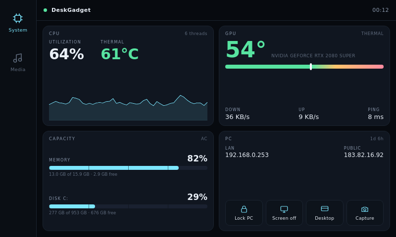
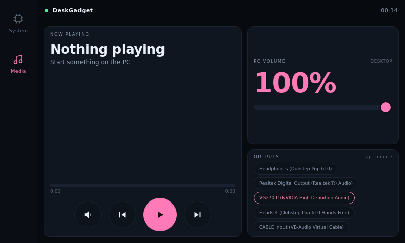

# DeskGadget for Car Thing

The **System** and **Media** modules of [DeskGadget](https://github.com/issacjohn/deskgadget)
on a Spotify Car Thing, as one static page. No APK, no Android, no build step.





## What it is

The Car Thing runs Linux on an Amlogic S905D2 with ~488 MB of RAM. It can't run
the Android app, but its Chromium kiosk can run a web client that speaks the
same WebSocket protocol (`/ws`) the phone uses.

This repo is that client, deliberately small: one HTML file, one stylesheet,
one script, flat colours, no blur, no animation loop, one canvas redraw per
data change. Memory matters here — the stock firmware ships `earlyoom`
configured to kill anything matching `chrome` the moment RAM runs low, which is
why heavier pages make the device appear to restart.

It shows only:

| Module | Contents |
|---|---|
| **System** | CPU utilization + package temperature + 60 s history, memory/disk capacity, GPU core temperature with hot spot and memory junction, download/upload/ping, LAN/public IP, and the PC actions (lock, screen off, desktop, capture) |
| **Media** | now playing (title, artist, source, seek), transport (mute, previous, play/pause, next), PC volume with − / + steps and a slider, output devices |
| **+ up to two more** | any other enabled module renders in a compact generic layout (Weather, News, Drives, Shortcuts, AudioMesh) |

Camera, AudioMesh, Windows, News, Weather and the mouse/keyboard pad are not
part of this client.

## Requirements

- DeskGadget **1.3.11 or newer** running on a Windows PC
- A Car Thing with the DeskThing client (or any Chromium kiosk) and adb access
- The USB cable the device came with

No Wi-Fi is needed: the client reaches the PC through `adb reverse`.

## Install (Windows)

```powershell
powershell -ExecutionPolicy Bypass -File tools\car_thing.ps1
```

The script:

1. copies `index.html`, `style.css` and `app.js` to **`/var/deskgadget`** — the
   device's data partition, so the client survives a reboot;
2. backs up the DeskThing start page and replaces it with a redirect, so the
   kiosk boots into DeskGadget (`-Restore` puts DeskThing back);
3. runs `adb reverse tcp:8787 tcp:8787`, giving the device a route to the PC;
4. restarts the kiosk.

With more than one adb device connected, pass the serial:

```powershell
powershell -ExecutionPolicy Bypass -File tools\car_thing.ps1 -Serial 8558R685Q811
```

### Disable DeskThing

DeskGadget only needs the kiosk; DeskThing's native helper
(`qt-superbird-app`, supervisor program `superbird`) is not used by this client.
Stop it permanently with:

```powershell
powershell -ExecutionPolicy Bypass -File tools\car_thing.ps1 -DisableDeskThing
powershell -ExecutionPolicy Bypass -File tools\car_thing.ps1 -EnableDeskThing   # undo
```

That sets `autostart=false` for the `superbird` program in
`/etc/supervisord.conf` and stops it now. Safe to do: Chromium, the touch
screen, `sp-als-backlight` and `earlyoom` are separate supervisor programs, and
the DeskThing webapp is already bypassed by the redirect. `-Restore` brings the
whole original setup back.

### Start automatically

The device side is automatic: the kiosk's start page redirects to the client,
so turning the Car Thing on lands on DeskGadget. Verified across a cold boot.

The tunnel is the PC half. `adb reverse` belongs to the adb session, and the
adb server keeps it across device reboots and replugs — so while the PC stays
on, starting the Car Thing is enough. After a PC reboot, restore it once:

```powershell
powershell -ExecutionPolicy Bypass -File tools\install_autostart.ps1
```

That registers a per-user task at logon which waits for the device and makes a
**single** `adb reverse` attempt. It is deliberately not a watcher: this
firmware's adbd can answer with `protocol fault` and drop the whole USB link,
so retrying is what breaks it. One attempt per logon is safe; the log is at
`%LOCALAPPDATA%\DeskGadget\carthing-tunnel.log`.

### Manual

```sh
adb reverse tcp:8787 tcp:8787
adb shell mkdir -p /var/deskgadget
adb push index.html style.css app.js /var/deskgadget/
adb shell supervisorctl restart chromium
```

The kiosk loads `file:///var/deskgadget/index.html`; you can also open that URL
in a browser on the device.

## Preview on a PC

```sh
python -m http.server 8099
```

Open <http://127.0.0.1:8099/?view=system> or `?view=media`. The page connects to
`ws://127.0.0.1:8787/ws`; point it elsewhere with `?host=192.168.0.10&port=8787`.

## How it connects

### Four modules, four buttons

The rail loads at most **four** modules: System and Media first, then the next
modules the device has enabled, in the dashboard's order. Camera is skipped —
there is nothing to capture on a Car Thing.

The Car Thing's hardware buttons arrive as ordinary key events in the kiosk:

| Button | Action |
|---|---|
| `1`–`4` | select module 1–4 |
| back (Esc) | previous module |
| arrows | cycle modules; up/down adjust volume |
| enter | play/pause on Media |

The on-screen volume has − / + buttons and a wide slider; both drive the PC's
volume through the Media module.

### Protocol

The client sends the normal DeskGadget hello:

```json
{"v":1,"type":"hello","device_id":"carthing-xxxxxxxx","device":{"name":"Car Thing","model":"Car Thing"}}
```

The server answers with a welcome containing the pages, then pushes
`{"type":"page","module":"system"|"media",...}` whenever something changes.
Actions go back the same way as the phone:

```json
{"v":1,"type":"action","module":"media","action":"set_volume","payload":{"value":40}}
```

The device shows up in the DeskGadget dashboard as **Car Thing**. If System or
Media is disabled for it there, the page stays empty — enable both.

## Design notes

- **800×480, dpr 1.** Two zones: a 74 px rail and a 2×2 grid (System) or a
  two-column player (Media).
- **Cheap by construction.** No `backdrop-filter`, no gradients beyond two
  static ones, no `requestAnimationFrame`, no images. Text nodes are updated in
  place and only when the value changed.
- **Safe for Chrome 69.** The kiosk is Chromium 69: no flex `gap`, no optional
  chaining, no `inset`, no multi-position colour stops.
- **Touch first.** Every control is at least 44 px tall; the volume slider has a
  26 px thumb.

## Credits

- [DeskGadget](https://github.com/issacjohn/deskgadget) — the server and protocol
- [DeskThing](https://github.com/ItsRiprod/DeskThing) — the Car Thing client this
  runs beside; not affiliated
- Spotify Car Thing — the hardware, unsupported by Spotify since 2024

## License

MIT © 2026 Isaac John
